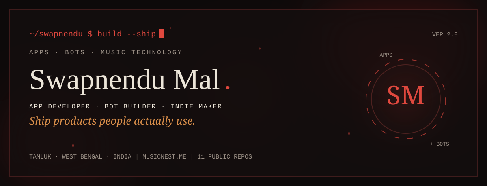
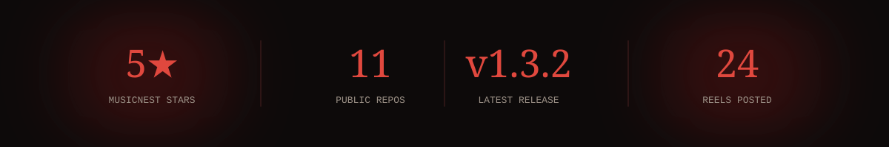
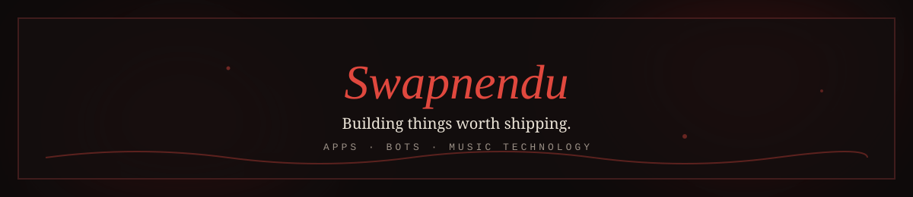

<div align="center">



<a href="https://musicnest.me"></a>
<a href="https://swapnendu-portfolio.base44.app"></a>
<a href="https://www.instagram.com/ai.dev_swapnendu"></a>
<a href="https://github.com/dev-stack12692/MusicNest/releases"></a>


</div>

---

**`01 · ABOUT`**

## Hello, I'm Swapnendu.

I build things end to end and ship them myself - apps, bots, and the sites that sell them. My main product is **MusicNest**, a free, ad-free music app for Android. I design, code, market, and support everything solo from Tamluk, West Bengal.

---

**`02 · RIGHT NOW`**

## Currently cooking.

```text
> MusicNest v1.3.2 shipped - equalizer, karaoke lyrics, Listen Together
> next MusicNest release            [in progress]
> Instinct Agency - demo sites for local businesses across India
> daily Instagram reels @ai.dev_swapnendu
```

---

**`03 · SELECTED WORK`**

## Products, not assignments.

**`01 · ANDROID · MUSIC · 2025-`**
### MusicNest
*Free, ad-free music streaming - no subscription, ever.*
`KARAOKE LYRICS ▸ LISTEN TOGETHER ▸ BUILT-IN EQUALIZER ▸ PODCASTS ▸ SPOTIFY IMPORT`
`v1.3.2` `free` `0 ads` `musicnest.me` · releases on GitHub, source private · [repo](https://github.com/dev-stack12692/MusicNest) · [site](https://musicnest.me)

**`02 · WEB AUDIO · BROWSER · 2025`**
### Vocal Polish
*Clean up a vocal and mix it with a backing track, right in the browser.*
`NOISE REMOVAL ▸ EQ ▸ MIXDOWN ▸ NO UPLOAD`
[repo](https://github.com/dev-stack12692/vocal-polish)

**`03 · WEB · PRODUCTIVITY · 2025`**
### NoteRoll
*A notes app that stays out of your way.*
`FAST ▸ SIMPLE ▸ LIVE AT GITHUB PAGES`
[repo](https://github.com/dev-stack12692/noteroll) · [live](https://dev-stack12692.github.io/noteroll/)

**`04 · PYTHON · DISCORD · 2025`**
### Axis & MusicNest Bots
*Discord bots that moderate servers and play music.*
`DISCORD.PY ▸ SLASH COMMANDS ▸ SELF-HOSTED`
[Axis](https://github.com/dev-stack12692/Axis-Discord-Bot) · [MusicNest Bot](https://github.com/dev-stack12692/MusicNest-Discord-Bot)

---

**`04 · TOOLKIT`**

## What I build with.

| | |
|---|---|
| **`01 LANGUAGES`**<br>**Python · JavaScript · TypeScript**<br>`HTML · CSS · SQL` | **`02 FRONTEND`**<br>**React · Tailwind · Three.js**<br>`responsive · animated · dark-first` |
| **`03 BACKEND & APIS`**<br>**Node.js · FastAPI**<br>`REST APIs · auth · automation` | **`04 DATA & CLOUD`**<br>**Supabase · Firebase · PostgreSQL**<br>`Render · GitHub Pages · Linux` |
| **`05 MOBILE`**<br>**Android apps**<br>`MusicNest - shipped, v1.3.2` | **`06 BOTS & TOOLING`**<br>**discord.py · GitHub Actions**<br>`moderation · music · self-hosted` |

---

**`05 · COMMIT LOG`**

## A year of building.

<div align="center">


</div>

---

**`06 · TROPHIES`**

## Shelf of small wins.

<div align="center">



</div>

---

**`07 · CONNECT`**

## Let's build something worth using.

<div align="center">

<a href="https://musicnest.me"></a>
<a href="https://swapnendu-portfolio.base44.app"></a>
<a href="https://www.instagram.com/ai.dev_swapnendu"></a>
<a href="https://github.com/dev-stack12692"></a>



</div>
